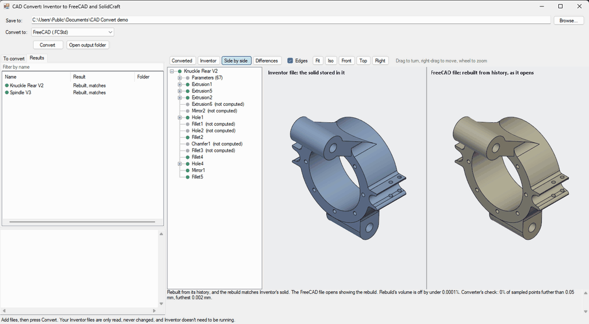
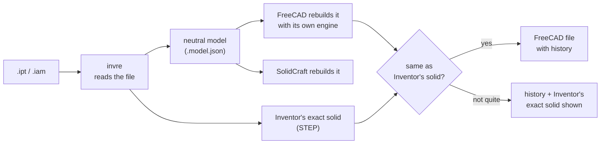

# CAD Convert

**Move CAD models from one program to another with their design history intact, not just their shape.**

[](LICENSE)




*A knuckle converted from Inventor: the solid stored in the Inventor file (left) and the FreeCAD part rebuilt
from its history (right), on one camera. They match to under 0.0001% in volume.*

Most converters hand over a dead solid: the right shape, but no sketches, dimensions or features left to edit. CAD
Convert rebuilds the model step by step in the target program, so you can keep designing there as you did in the
original: change a dimension, and the part updates.

Today it reads **Autodesk Inventor** parts (`.ipt`) and assemblies (`.iam`) and writes **FreeCAD**, with
**SolidCraft** as a second output. More formats can follow: the reader turns a file into a neutral model, and each
writer builds from that.

**Inventor versions:** tested with files saved by Inventor 2023 and Inventor 2026. Files from other versions aren't
checked yet; they may convert, or may not.

## Highlights

- **No Inventor needed.** The `.ipt` and `.iam` files are read directly, byte by byte, and never changed.
- **The history, not just the shape.** Parameters and their formulas, sketches with their constraints and dimensions,
  and the features in Inventor's order, all linked: dimensions drive the sketches, parameters drive the features.
- **Checked against the original.** Every rebuilt part is compared with the exact solid Inventor stored in the file:
  volume, every surface, and points sampled on both. Where a rebuild falls short, Inventor's exact solid goes into the
  FreeCAD file too and is what shows, with the history beside it. You always get the right shape.
- **Assemblies too.** Parts placed as in Inventor, constraints and joints carried as FreeCAD joints.
- **See the difference.** The app shows the Inventor input and the FreeCAD output side by side on one camera, the
  differences between them, and each step of the history.
- **Standalone.** One folder with a trimmed-down FreeCAD inside (about 350 MB, 140 MB zipped). Nothing to install.

## What it carries

| Inventor | In FreeCAD |
|---|---|
| Parameters, formulas, units | A parameter table, formulas as expressions |
| Sketches, constraints, dimensions | Sketcher sketches, kept where they still solve exactly as Inventor has them, attached to the face or work plane they were drawn on so they move with it |
| Extrude (one side, two, symmetric, tapered, to next, to a face or work plane, from-to), revolve | Pad, Pocket, Revolution, Groove |
| Sweep along a path or guide rail | AdditivePipe, SubtractivePipe |
| Hole: drilled, counterbore, countersink, spot face | Hole, at the tap drill size where threaded (threads are cosmetic in Inventor's solid too) |
| Fillet, chamfer | Fillet and Chamfer; where FreeCAD's own refuses, a round or chamfer built from a sketch profile |
| Mirror, rectangular and circular patterns (including mid-plane) | Mirrored, LinearPattern, PolarPattern |
| Shell (faces removed, inward or outward), loft (with centerline, or to a point), sheet metal plates and flanges | Thickness, Loft or multi-section Pipe, Pads |
| Imported bodies (from STEP or other CAD) | A body on the shape as it was imported, taken from the file's own history, with the features after it rebuilt on top |
| End of Part, suppressed and failing features | The body's Tip; left out, as in Inventor's solid |
| Assembly constraints and joints | FreeCAD Assembly joints |

Not yet: sweep taper and twist, loft rails and closed lofts, shells to both sides, a second imported body, surface
features, sketch-driven patterns, 3D sketches, and work planes tied to the geometry that defines them.

## How it works



1. **`invre`** (C#) unpacks the Inventor file, decodes the parametric model (sketches, features, parameters, the B-rep
   and how its faces and edges are named) and writes a neutral model.
2. It also writes Inventor's own stored solid as STEP, record for record: the reference the rebuild is measured against.
3. **`build_model.py`** runs inside FreeCAD and rebuilds the model with FreeCAD's own engine, finding edges by their
   geometry on the shape it has built so far, so the file is always native and a feature FreeCAD refuses is known at once.
4. The result is compared with Inventor's solid, and the verdict goes in a report beside the FreeCAD file.

## Status

November 2026, on 141 real parts and 31 assemblies from one project, and on a library of small test parts:

| | |
|---|---|
| Real parts | **120 of 141** match Inventor's solid: 70 rebuilt with their history, and 50 vendor or imported bodies with no history to carry, rebuilt on their shape as imported |
| Test library | **161 of 236** small Inventor parts match; 58 are sketches only |
| Changing a parameter afterwards | 84 of 107 sampled dimensions, changed by 5%, give the same shape as Inventor does |
| Assembly joints | 281 of 345 carried across 31 assemblies, nothing moved |

The biggest gap left is FreeCAD's fillets: it refuses some rounds Inventor makes.

## Quick start

**To try it:** download `CAD-Convert-0.1.0-windows.zip` from the
[latest release](https://github.com/CNCaddict/CAD-Convert/releases/latest), unzip it anywhere and run
`CadConvert.exe`. Nothing to install: a trimmed FreeCAD is inside, and Inventor isn't needed.

**To build it:** Windows, and [FreeCAD 1.1.4](https://www.freecad.org) (the portable build). Building needs nothing
more: the C# compiler comes with Windows (.NET Framework 4).

```bash
tools\build.cmd
```

Then run `tools\bin\CadConvert.exe`, add files or a folder (or drop them on the window), and press Convert. It finds
FreeCAD through `CADCONVERT_FREECAD`, in `%LOCALAPPDATA%\CADConvert`, or in `engine` beside the program;
`tools\package.cmd` makes the standalone folder.

From the command line:

```bash
tools\bin\invre.exe convert "Part.ipt" out
```

The output folder gets `Part.FCStd`, `Part.step`, and in `reports` the neutral model and a report of what came across.
Run `invre.exe` with no arguments for the other commands.

## Testing a change

The test library in `corpus/generated` is 236 small parts and 97 assemblies made in Inventor 2026, each showing one
feature or one awkward case, with Inventor's own report on each. Run with FreeCAD's `python.exe`:

```bash
python tools\freecad\case_test.py corpus\generated work\cases
```

It rebuilds them all in about two minutes, compares each with Inventor's stored solid, and lists first any part that
matched before (`tools/freecad/cases_baseline.json`) and doesn't now. `tools/freecad/quick_test.py` does the same for
real parts.

When a real part goes wrong, the fastest fix is to make the smallest part that shows the same thing: a variant in
`Experiments()` in `tools/invre/Inventor.cs`, made with `invre gen <experiment>/<variant> corpus\generated` (this needs
Inventor 2026 open), then `python tools\scrub_corpus.py`, which takes the Windows user name out of the new files.

## Repository

| Folder | What's in it |
|---|---|
| [`tools/invre`](tools/invre) | The Inventor reader: file structure, sketches, features, B-rep, naming, the neutral model, the STEP writer, and the code that drives Inventor to make test parts |
| [`tools/convert`](tools/convert) | The Windows app, with its viewer |
| [`tools/freecad`](tools/freecad) | The FreeCAD builder, assemblies, the display pass, and the tests |
| [`tools/solidcraft`](tools/solidcraft) | The SolidCraft builder |
| [`corpus/generated`](corpus/generated) | The test library |

## Notes

- The Inventor format was worked out from files alone (generated test parts, compared with what Inventor's API reports
  about them), never by taking Inventor itself apart.
- Not affiliated with or endorsed by Autodesk, the FreeCAD project or SolidCraft. Autodesk and Inventor are trademarks
  of Autodesk, Inc.
- FreeCAD isn't in this repository. The standalone package includes a trimmed copy of it under its own licence
  (LGPL-2.1-or-later).

## License

[MIT](LICENSE): anyone may use, copy, change and share it, for any purpose.
